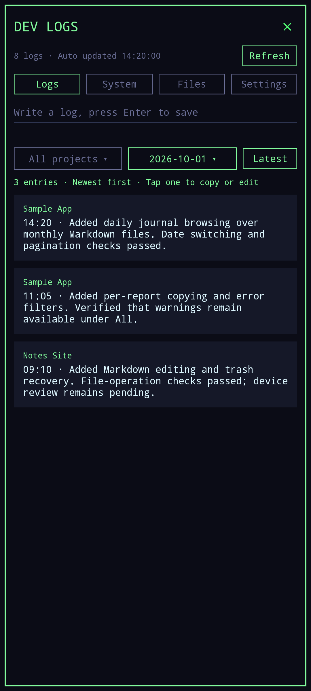
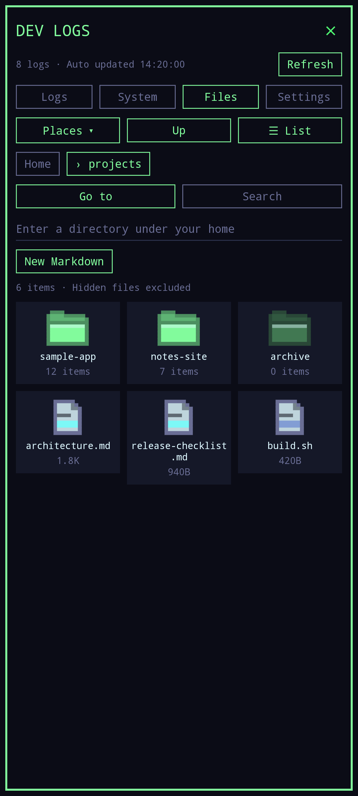
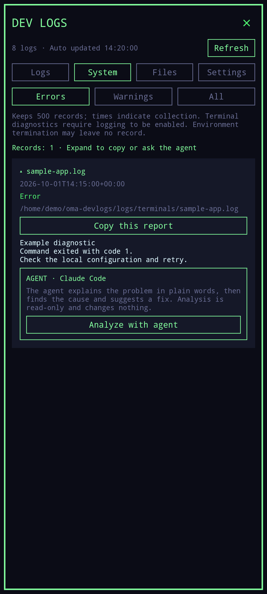
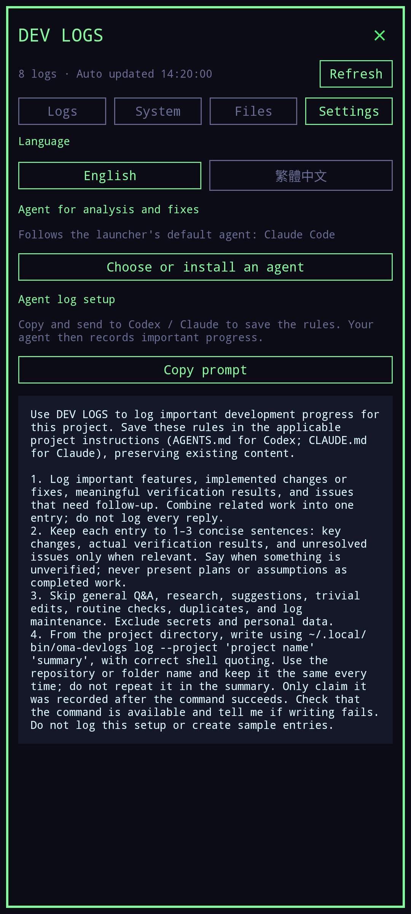

# DEV LOGS

Development logs, project notes and Linux diagnostics for Omalauncher. English and Traditional Chinese interfaces.

## Preview

Screenshots use fixed English examples rendered by the launcher. No personal log entries, project files or diagnostics are included.

| Home widget | Logs by day |
| --- | --- |
| [](docs/screenshots/dev-logs.png) | [](docs/screenshots/logs.png) |

| Project files | System diagnostics | Settings |
| --- | --- | --- |
| [](docs/screenshots/files.png) | [](docs/screenshots/errors.png) | [](docs/screenshots/settings.png) |

## What it does

- **Logs:** write concise development milestones. Browse and switch by day, with 40 entries per page. Tap an entry to copy, edit (the time stays) or delete it; deleted lines are kept in local trash. Each entry can name its project; filter by project next to the date, and a log written while a project is selected joins it. Storage uses one Markdown file per month, with a full date and time on each entry.
- **Files:** browse inside your home directory as a grid of pixel folder and file icons (the default) or as a list, with a tappable path; search names (and optionally Markdown text) below the current folder; create, view and edit Markdown; confirm deletion before moving a file into recoverable local trash. Hidden files are omitted; file browsing uses 40 items per page.
- **System:** collect local widget, style, guest-shell and selected service diagnostics. Filter **Errors / Warnings / All**; Errors is the default. Expand a record and copy only that report. The collector keeps the newest 500 records. **Analyze with agent** asks the launcher's default coding agent to explain the problem, list likely causes and suggest a fix; **Fix in terminal** lets the agent carry out the fix where you can watch it.
- **Settings** (the fourth tab; **Refresh** is at the top right): choose English on the left or 繁體中文 on the right; messages, copied reports and the heading of a new log file follow it. Copy project instructions for Codex or Claude to record important development changes, verification results and unresolved problems in 1–3 sentences.

Agent logging works when an agent with local command access saves and follows the copied instructions. DEV LOGS does not capture every reply or summarize conversations automatically. It calls an agent only when you tap **Analyze with agent** or **Fix in terminal**, as described under Agent analysis. General Q&A, routine checks and trivial edits should be skipped. The **Auto updated** time indicates that the displayed data was refreshed, not that a new log entry was written.

## Install from GitHub

Requires Omalauncher with Arch Linux and OWL 6. The installer can install `python`, `bash`, `coreutils`, `less` and `micro` through pacman. Two extras are optional and not installed for you: `gum` for the menu of `oma-devlogs open`, and `foot` for `oma-devlogs-terminal`.

```sh
git clone --branch dev-logs https://github.com/WeeboWIZ/Omalauncher_Tools.git
cd Omalauncher_Tools
python dev-logs/install.py
```

Use `python dev-logs/install.py --skip-deps` only when those packages are already available. This installer installs DEV LOGS independently; the repository's root `install.py` installs the voice and dictation tools.

For an update, pull this branch and rerun the same installer. Existing notes, monthly log files, older daily log files and collected diagnostics are preserved. Replaced programs are backed up beneath `~/.local/share/oma-devlogs/install-backups/`. Updates do not edit your agent instructions.

## Install from the widget store

The submission folder is [`store/widgets/weebowiz/dev-logs/`](../store/widgets/weebowiz/dev-logs/). It is prepared in this branch; its presence here does not mean it has been submitted or approved by the store.

After importing `widget.owl`, tap **Set up**. The widget contains the helper programs; setup writes them to `~/.local/bin/` and `~/.local/share/oma-devlogs/`. It creates empty workspace folders and never adds sample log entries. **Update** replaces program files after a widget update. Setup does not download or run another script, change shell startup files, or replace the system terminal. Setup output is saved at `~/.cache/oma-devlogs/setup.log`.

## Set up agent logging

1. Open DEV LOGS and tap **Settings** at the top right.
2. Under **Agent log setup**, tap **Copy prompt**.
3. Paste it into your local Codex or Claude session. Ask the agent to save the rules in the project's `AGENTS.md` or `CLAUDE.md`, preserving existing instructions.
4. After meaningful work, the agent writes a concise entry using the local command. Confirm that the new entry appears in Logs.

The same command can be used manually:

```sh
~/.local/bin/oma-devlogs log --project 'Sample App' 'Implemented daily filtering. Pagination checks passed; device review remains pending.'
~/.local/bin/oma-devlogs history
~/.local/bin/oma-devlogs history 2026-10-01
~/.local/bin/oma-devlogs browse ~/projects
```

Without `--project`, the project is the git repository the command runs in, or the folder directly under `~/projects`; otherwise the entry has no project. The file stores it as `- 2026-10-14 10:00 · [Sample App] …`. Dates above are examples. Agent instructions should require real results, state when verification is pending, and avoid secrets or duplicate entries.

## Agent analysis

DEV LOGS uses the agent picked in Omalauncher's prompt bar (`~/.config/omalauncher/agent`), or the first installed one. Claude Code and Codex analyze in the background in read-only mode (`claude -p --permission-mode plan`, `codex exec --sandbox read-only`); other agents have no reliable read-only flag, so they analyze in a terminal. Only the selected record and the system type are sent, and the prompt tells the agent the record is data, not instructions. The result stays in `~/.local/share/oma-devlogs/agent/`; you can leave the page while it runs.

Fixes always run in a terminal with the agent's own permission prompts. Afterwards DEV LOGS collects diagnostics again and marks the record unsolved if the same source fails again.

## Files and recovery

```text
~/oma-devlogs/
├── notes/                  Markdown notes
├── journal/YYYY-MM.md      Development log: one file per month, browsed by day
└── logs/
    ├── system-errors.sqlite3
    └── terminals/          Optional terminal diagnostics
```

Markdown editing opens `micro` (Ctrl+S saves; Ctrl+Q exits). Deleted Markdown files move to `~/.local/share/oma-devlogs/trash/<id>.md`; the matching JSON contains the original path. Restore a file by moving it back after checking for a filename conflict. Symlink entries do not offer edit/delete actions.

## Diagnostics and privacy

The collector reads local widget `.errors/`, style `errors.txt`, `/tmp/.guest-shell-err-*`, existing terminal diagnostic files and error contexts in the voice, dictation and pixel-console service logs. It has no background service: the widget runs it once a minute while its page is on screen, and when you tap **Refresh**. A pass that finds nothing new does not write to the database. It does not access Android logcat, general terminal screen contents, Codex/Claude conversations or agent API credentials. Nothing is uploaded automatically: an analysis sends one record to your agent only when you ask for it. Copying a report puts its text on the Android clipboard for you to share.

Terminal logging is opt-in. To open a terminal that saves its stderr and abnormal exit code, run:

```sh
~/.local/bin/oma-devlogs-terminal
```

This helper needs `foot` (`pacman -S foot`) and invokes `/usr/bin/foot` without replacing it. It does not record terminal input or ordinary stdout. Existing terminals and terminals opened by other entry points are not automatically captured. Raw terminal files are not automatically deleted; only the collected database history is limited to 500 events. Logs may contain sensitive text printed by other programs, so inspect a report before sharing it.

Severity filters use local text rules: explicit errors take priority, known warnings are warnings, and unknown messages stay informational. They assist browsing and do not establish a crash cause. Times indicate collection time, and Android or PRoot termination may leave no diagnostic record.

## Development and store checks

```sh
python dev-logs/tools/build_store.py
python -m unittest discover -s dev-logs/tests -v
```

The build produces the same self-contained widget used by the GitHub installer. Source files and tests are in this folder; the existing voice/dictation package is separate.

To regenerate screenshots on an Omalauncher device, use a Python environment with Pillow and run `python dev-logs/tools/screenshots.py`. The script creates temporary inert widgets with fixed data, captures the launcher's PNGs, compresses each below 300 KB, copies the home preview into the store folder, and removes the temporary widgets. See [screenshot details](docs/screenshots/README.md).

Store review from a checkout of `SimonSchubert/omarchy-widgets`:

```sh
java -jar tools/owl.jar review /path/to/Omalauncher_Tools/store widgets/weebowiz/dev-logs/widget.owl
```

## 繁體中文

DEV LOGS 提供開發日誌、專案 Markdown 與本機系統錯誤紀錄。畫面仍按每日顯示及切換；日誌存成每月一份 `YYYY-MM.md`，每筆保留完整日期與時間。

安裝：在倉庫根目錄執行 `python dev-logs/install.py`。商店版匯入 `widget.owl` 後按「安裝」，即可寫入內嵌程式；更新會保留筆記、日誌與錯誤資料。新使用者從空白日誌開始，不會看到開發者的紀錄。

「更新」在右上角；「設定」是第四個分頁，可切換語言，左邊 English、右邊繁體中文。「Agent 記錄設定」可複製提示詞給 Codex／Claude，請 agent 保存規則後，以 `~/.local/bin/oma-devlogs log '內容'` 記錄重要功能、變更、驗證結果與待追蹤問題。同一工作合併一筆、簡潔 1–3 句，一般回覆不記錄。工具沒有自動讀取全部回覆或額外呼叫 AI API；「自動更新」只代表畫面資料刷新。

「日誌」點一條即可複製、編輯（保留時間與專案）或刪除（原文移至回收區）。每筆可標記專案（`log --project '名稱'`，未指定時取 git 倉庫名稱或 `~/projects` 下的資料夾名），日期旁可依專案篩選；選定專案時手動寫的日誌也歸入該專案。「專案」可切換列表或像素資料夾圖示，並可搜尋目前目錄下的檔名與 Markdown 內容。

「系統」紀錄由工具讀取本機診斷檔，預設只看錯誤，可切換警告／全部；展開後只複製該筆報告。「Agent 分析」請啟動器的預設 agent 以只讀方式說明問題、原因與修復建議；「在終端修復」在終端中由 agent 執行；「匯報給 Omalauncher 作者」脫敏後開啟預填的 GitHub Issue，由你確認送出。一般終端不會自動被錄製，需用 `~/.local/bin/oma-devlogs-terminal` 開啟有 stderr 診斷的終端。收集時間不等於發生時間，紀錄也不保證能判斷閃退原因。

本機資料留在 `~/oma-devlogs`，刪除的 Markdown 可從 `~/.local/share/oma-devlogs/trash/` 還原。套件不含私人日誌、資料庫、會話或密鑰；未自動提交商店或傳送報告。
