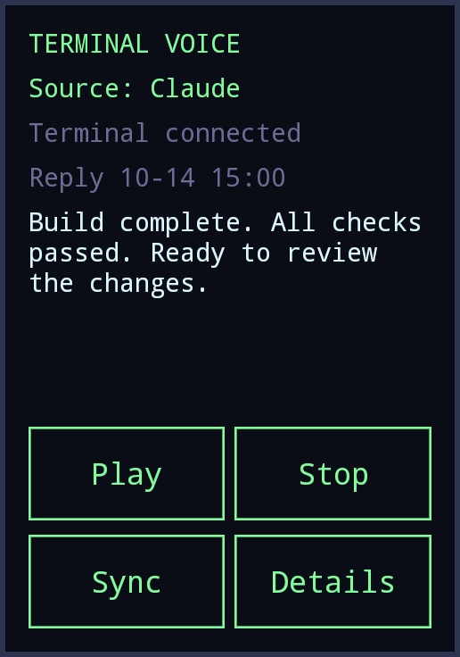
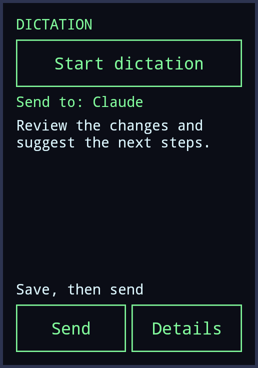

# Current widget screenshots

Actual launcher rendering with fixed English sample data. Every PNG is smaller
than 300,000 bytes. The home tiles have no language button; each Details screen
contains the interface language selector.

| Terminal Voice | Dictation |
|:---:|:---:|
| [](terminal-voice.png) | [](dictation.png) |

[Overview](overview.png) · [Terminal Voice details](terminal-voice-details.png) ·
[Dictation details](dictation-details.png)

Both screenshots use 3×4 cells. Dictation's default size is still 3×3; its review
tile uses 3×4 so the complete example fits. No personal conversations are shown.
The dictation web page has been redesigned but has no new screenshot.

`manifest.json` records the dimensions, byte sizes and SHA-256 hashes of every
image. `index.html` is an optional local gallery.

Regenerate on an Omalauncher phone with Pillow installed:

```sh
python tools/store_preview.py
```

The script creates temporary English demo widgets, runs `owl-check`, saves the
images here and removes its demo widgets and runtime preview files after success.
Check the output visually after regeneration; the size check cannot detect
clipped text. These images document the UI, not a microphone or playback test.
