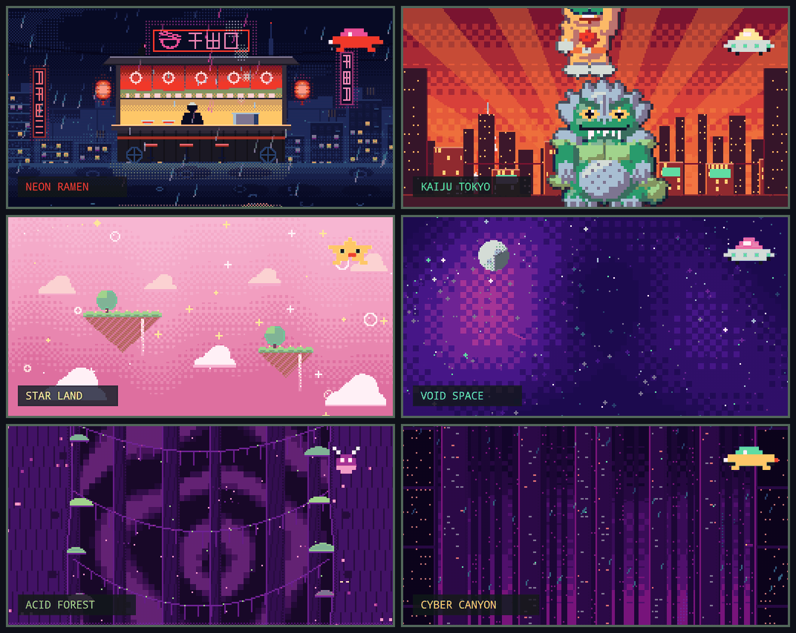
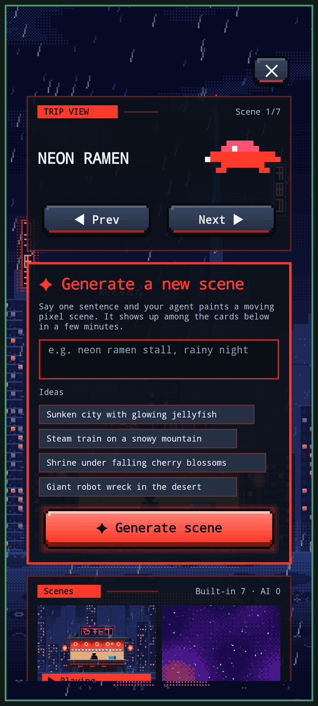
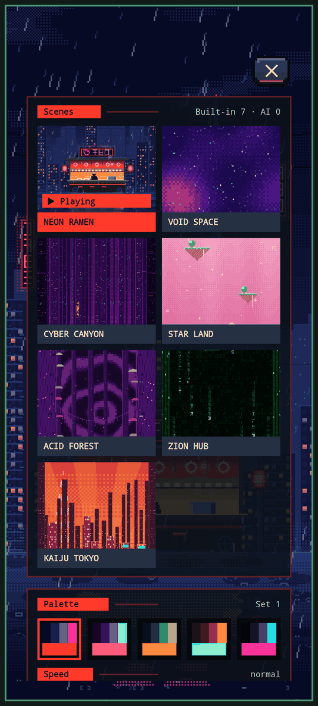

# Trip View

Animated pixel-art scenes for the [Omalauncher](https://github.com/SimonSchubert/omalauncher) home screen. Pick one of seven hand-made scenes, or describe a new one in a sentence and your terminal agent (Claude Code or Codex) paints it.



| Full-screen page | Scene cards |
| --- | --- |
| [](docs/screenshots/screen.png) | [](docs/screenshots/cards.png) |

Screenshots are rendered by the launcher with the English interface.

<details open>
<summary><strong>English</strong></summary>

## Scenes

| Scene | What moves |
|---|---|
| **Neon Ramen** (default) | Rain, rising steam, a flickering neon sign, swinging lanterns, ripples in the puddles, a train in the distance, a scrolling LED sign, lightning, a cat on the roof |
| **Kaiju Tokyo** | A film set: a soft-vinyl dinosaur, gorilla, hero and three-eyed duck play five acts on wires |
| **Star Land** | Pastel clouds, floating islands with waterfalls, twinkling stars, rising bubbles |
| **Void Space** | Flowing nebula, two star layers, shooting stars, the moon |
| **Acid Forest** | Breathing glow mushrooms, swinging vines, fireflies, spores, blinking eyes |
| **Zion Hub** | Code rain, a rotating wireframe cube, data pulses, scan lines |
| **Cyber Canyon** | Endless towers, neon signs, flying cars, searchlights, slanted rain |

Every scene has five palettes; in Kaiju Tokyo each palette is a different act.

## Features

- **Fits any size**, from 2×2 to a full page. Larger tiles add the scene name and a row of buttons; **Hide** clears them so only the scene shows (tap the tile to bring them back).
- **A pixel pet** for each scene that bobs along and reacts when tapped. Optional **pixel clock** in the scene's colors. Both can be switched off.
- **Full-screen page** with the scene filling the whole screen: scene cards with previews, palettes, speed, sound, clock and pet switches.
- **Generate a scene with AI.** Type a sentence (for example "a shrine under falling cherry blossoms"). Your agent writes it as an AGSL shader, and Trip View checks it on the Linux side before it ever reaches the phone. A progress bar shows each step; generating takes a few minutes.
- **Wallpaper.** Freeze any moment as the launcher wallpaper. Every wallpaper is kept in `~/Pictures/pixbg`, and you can switch back to one from the album.
- **Languages:** English and 中文. **Custom** writes a prompt for your agent that adds a new language pack.
- Optional 8-bit sound effects (off by default).

## Install

Requires Omalauncher with Arch Linux and OWL 7.

```sh
git clone https://github.com/WeeboWIZ/Omalauncher_Tools.git
cd Omalauncher_Tools
python trip-view/install.py
```

The installer installs `python`, `python-pillow`, `glslang` and `libpulse` with pacman, copies the program to `~/.local/share/pixbg`, adds the `pixbg` command (also `tripview`) to `~/.local/bin`, checks and bundles the scenes, and adds the widget to page 3. Scenes you generated are kept when you update. Use `--skip-deps` when the packages are already installed, and `--link` to run from the checkout while developing.

Run the tests with `python -m unittest discover trip-view/tests`.

AI generation uses the `claude` CLI with Claude Opus 5.5 by default. Switch it with `pixbg agent codex [model]` or `pixbg agent claude [model]`.

## Safety

A broken or heavy full-screen shader can make the GPU time out, and Android then restarts the whole launcher. Trip View never sends one to the phone unchecked. Every scene, built-in or generated, first passes `pixbg check` on the Linux side:

- it compiles with glslangValidator;
- it follows AGSL's rules (constant loops of at most 16 steps, no `while`, no arrays, no textures);
- it stays within a per-pixel GPU budget.

A generated scene that fails goes back to the agent with the errors, at most three times.

## Command line

| Command | Does |
|---|---|
| `pixbg list` / `pixbg use <id>` | List scenes / switch to one |
| `pixbg gen <sentence>` | Generate a scene with your agent |
| `pixbg check [id]` | Check scenes offline (compile, AGSL rules, GPU cost) |
| `pixbg wall [id]` | Freeze a scene as the launcher wallpaper |
| `pixbg walls` / `setwall <file>` / `rmwall <file>` | Wallpaper album |
| `pixbg thumbs [--all] [id]` | Redraw the scene card previews |
| `pixbg lang <code>` / `pixbg langs` | Interface language |
| `pixbg agent <claude\|codex> [model]` | Agent used for generation |

## Add a language

On the full-screen page, open **Language → Custom**, type the language and copy the prompt to your agent. To do it by hand, copy `app/lang/en.json` to `app/lang/<code>.json`, translate the values, then run `pixbg lang <code>` and `pixbg preview` to check the layout.

## Layout

```
app/          the pixbg tool, the offline checker, sound effects, the shader header
app/scenes/   scenes: <id>.agsl plus optional <id>.actors.json (sprites and choreography)
app/lang/     language packs
widgets/      30-trip-view.owl
docs/         screenshots
tests/        unittest suite
install.py    standalone installer
```

</details>

<details>
<summary><strong>中文</strong></summary>

## 場景

| 場景 | 會動的東西 |
|---|---|
| **霓虹拉麵**（預設） | 雨、湯鍋蒸氣、會故障的霓虹招牌、搖晃的燈籠、水窪漣漪、遠方電車、LED 跑馬燈、閃電、屋頂上的貓 |
| **特攝片場** | 片場裡的軟膠恐龍、大猩猩、英雄、三眼鴨嘴怪吊著鋼絲演出五幕戲 |
| **粉彩星島** | 粉彩雲朵、帶瀑布的浮空島、閃爍的星星、往上飄的泡泡 |
| **虛空** | 流動星雲、兩層星空、流星、月亮 |
| **螢光森林** | 會呼吸的發光蕈類、擺動的藤蔓、螢火蟲、孢子、會眨的眼睛 |
| **代碼雨** | 代碼雨、旋轉的線框立方體、資料脈衝、掃描線 |
| **賽博峽谷** | 無盡的摩天樓、霓虹招牌、飛車、探照燈、斜雨 |

每個場景有五組配色，特攝片場的每組配色是一幕不同的戲。

## 功能

- **各種尺寸都好看**，從 2×2 到整頁。大一點的磚塊會加上場景名稱和一排按鈕；按「隱藏」就只看場景，點一下磚塊叫回來。
- **數字寵物**：每個場景一隻像素吉祥物，會浮動，點一下有反應。**像素時鐘**用場景的配色，兩者都能關掉。
- **全螢幕頁**：場景滿版，有場景卡片（附縮圖）、配色、速度、音效、時鐘、寵物開關。
- **AI 生成場景**：輸入一句話（例如「櫻花飄落的神社」），你的 agent 會把它寫成 AGSL shader。Trip View 先在 Linux 這邊檢查過才送上手機，進度條會顯示每個步驟，大約要幾分鐘。
- **桌布**：把任何一刻定格成啟動器的桌布。每張都保留在 `~/Pictures/pixbg`，可以從相簿換回去。
- **語言**：English、中文。按「自定義」會產生一段提示詞，交給 agent 就能新增語言包。
- 8-bit 音效（預設關閉）。

## 安裝

需要裝了 Arch Linux、支援 OWL 7 的 Omalauncher。

```sh
git clone https://github.com/WeeboWIZ/Omalauncher_Tools.git
cd Omalauncher_Tools
python trip-view/install.py
```

安裝程式會用 pacman 安裝 `python`、`python-pillow`、`glslang`、`libpulse`，把程式複製到 `~/.local/share/pixbg`，在 `~/.local/bin` 加上 `pixbg` 指令（也叫 `tripview`），檢查並打包場景，再把小工具加到第 3 頁。更新時會保留你生成的場景。套件已經裝好時加 `--skip-deps`；開發時用 `--link` 直接從倉庫執行。

AI 生成預設用 `claude` CLI 和 Claude Opus 5.5。用 `pixbg agent codex [model]` 或 `pixbg agent claude [model]` 切換。

## 安全

壞掉或太重的全螢幕 shader 會讓 GPU 逾時，Android 會因此重啟整個啟動器。所以 Trip View 不會把沒檢查過的 shader 送上手機。每個場景，不論內建或生成，都要先在 Linux 這邊通過 `pixbg check`：

- 用 glslangValidator 編譯；
- 符合 AGSL 的規則（迴圈是常數次數且最多 16 次、沒有 `while`、沒有陣列、沒有貼圖）；
- 每個像素的運算量在 GPU 預算內。

生成的場景沒通過，會把錯誤交回給 agent 修正，最多三次。

## 指令

| 指令 | 作用 |
|---|---|
| `pixbg list` / `pixbg use <id>` | 列出場景／切換場景 |
| `pixbg gen <一句話>` | 交給 agent 生成場景 |
| `pixbg check [id]` | 在本機檢查場景（編譯、AGSL 規則、GPU 運算量） |
| `pixbg wall [id]` | 把場景定格成啟動器桌布 |
| `pixbg walls` / `setwall <檔名>` / `rmwall <檔名>` | 桌布相簿 |
| `pixbg thumbs [--all] [id]` | 重畫場景卡片的縮圖 |
| `pixbg lang <代碼>` / `pixbg langs` | 介面語言 |
| `pixbg agent <claude\|codex> [model]` | 生成用的 agent |

## 新增語言

在全螢幕頁打開「語言 → 自定義」，輸入想要的語言，把提示詞複製給你的 agent。手動做的話：把 `app/lang/en.json` 複製成 `app/lang/<代碼>.json` 並翻譯裡面的值，再執行 `pixbg lang <代碼>` 和 `pixbg preview` 檢查排版。

</details>

## License

Copyright (C) 2026 WeeboWIZ. All scenes, characters and pixel art (C) 2026 WeeboWIZ.

Trip View is free software under the [GNU General Public License v3.0 or later](LICENSE). This license covers the `trip-view/` folder; the rest of this repository keeps its own license.
